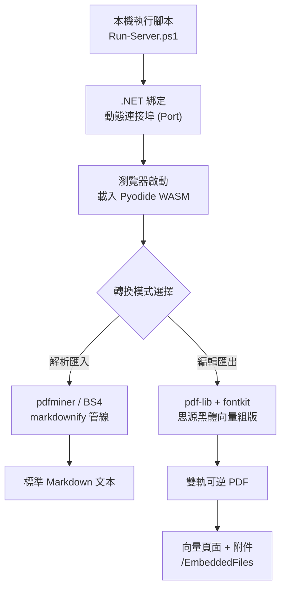
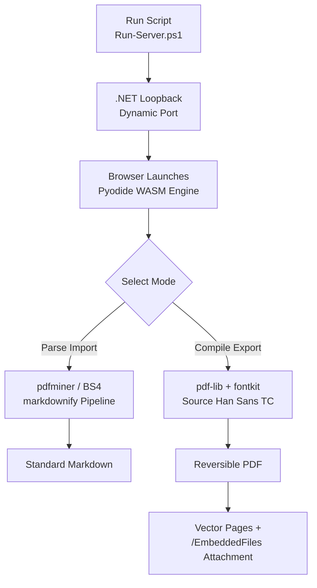
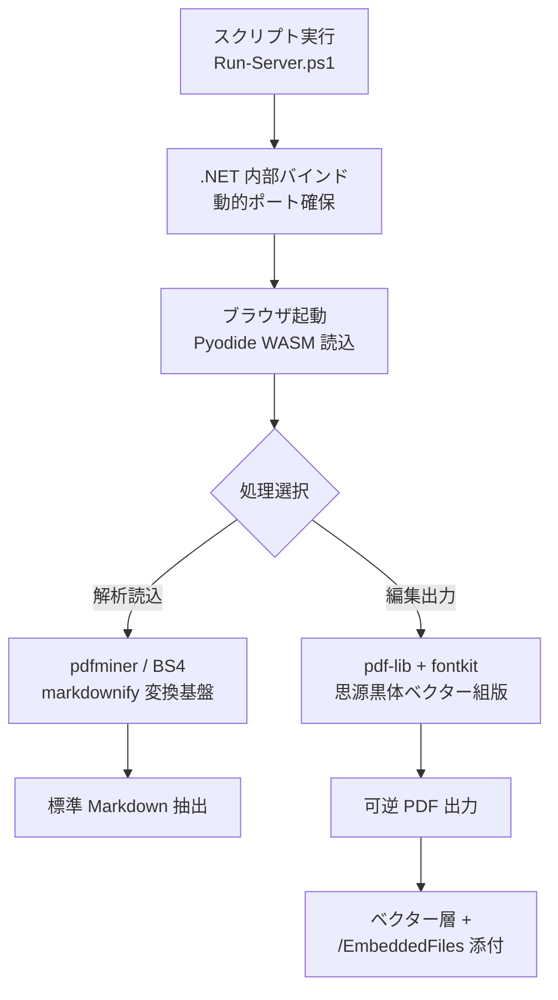

<!--
作者 startgo (startgo@yia.app)
授權預設 GPLv3
時間: 2026-11-09 16:50:00 UTC+8
版本: v1.31.3
-->

# MarkItDown Browser Edition (Pyodide WASM Engine)

[繁體中文](#繁體中文) | [English](#english) | [日本語](#日本語)

---

## 繁體中文

本專案是一個在瀏覽器端完全執行的文件轉換與雙軌無損可逆排版工具。架構上參考 [Microsoft MarkItDown](https://github.com/microsoft/markitdown) 的管線整合概念，但為**獨立實作的相容架構，非 Microsoft 官方套件**。

系統透過單一 PowerShell 啟動腳本，呼叫 `.NET HttpListener` 自動取得可用 Port 載入 Web 服務，核心運算全由 Pyodide (WebAssembly) 及 WASM 模組在前端沙盒執行，本機無須安裝 Python、編譯器或任何依賴庫。

### 系統架構圖 (System Topology)



### 核心規格與技術對照

| 功能維度 | 實作方案 | 技術細節與規格界限 |
| :--- | :--- | :--- |
| **運算架構** | 瀏覽器原生沙盒 (Zero-Install) | Pyodide `v0.26.2`、WASM、純客戶端運算，無外部伺服器資料傳輸 |
| **文件解析** | Python 轉譯管線 (In-Browser) | `pdfminer.six` (PDF 幾何啟發式擷取)、`beautifulsoup4`、`markdownify` |
| **可逆 PDF 匯出** | 雙軌封裝架構 (Dual-Track Core) | 視覺呈現由 `pdf-lib` + `fontkit` 渲染，原始代碼以 UTF-8 附加於 `/EmbeddedFiles` (`source.md`) |
| **字型與文字** | 思源黑體 (Source Han Sans TC OTF) | 子集化向量字型嵌入，支援純文字選取、外部複製與文字擷取 |
| **互動超連結** | PDF 原生 `/Link` URI 註解 | 解析 Markdown 連結與純網址，自動綁定點擊區域跳轉 |
| **流程圖渲染** | 圍欄穿透式拓撲向量引擎 | 支援 Mermaid 語法穿透與 DAG 拓撲特徵分類，向量方塊、菱形與箭頭自動排版 |
| **多國語系** | 外掛式 JSON Schema 架構 | 內建繁中與英文，支援外部動態載入（如日語 `jp.json`），含 JIS X 4051 禁則換行引擎 |

### 快速啟動

在 Windows PowerShell 執行以下命令（腳本預設採 UTF-8 with BOM 儲存）：

```powershell
Set-ExecutionPolicy -Scope Process -ExecutionPolicy Bypass
.\Run-MarkItDownServer.ps1
```

腳本將自動產生 `index.html`，以 Loopback TCP 取得空閒 Port，並開啟預設瀏覽器連線。

### 多語系擴充說明 (i18n Extension)

本專案支援免重構加入第三方語系。點擊介面「載入語系包 (Load i18n Pack)」並上傳符合規範的 JSON 檔案即可動態切換：

```json
{
  "langCode": "ja",
  "langName": "日本語",
  "translations": {
    "app_title": "MarkItDown (Pyodide WASM Engine)",
    "btn_export_pdf": "可逆PDFを出力",
    "tab_edit": "編集",
    "tab_preview": "プレビュー",
    "license_author": "作者: startgo (startgo@yia.app)",
    "ref_components_title": "コアコンポーネント参照："
  }
}
```

### 限制說明 (Known Limitations)

1. **PDF 幾何啟發限制**：PDF 輸入轉換為 Markdown 係依據字元座標與幾何啟發式（Heuristic）演算法重組，版面僅能近似還原標題、表格與清單；掃描版點陣圖 PDF 需額外進行 OCR，本工具不包含 OCR 引擎。
2. **PDF 規格界限**：匯出之 PDF 包含原始碼附件（可在匯入時 100% 還原原始 Markdown），但不可等同於 PDF/A-3 完整合規性認證。

---

## English

A browser-native document conversion and reversible dual-track PDF rendering tool. This project is inspired by the pipeline concepts of [Microsoft MarkItDown](https://github.com/microsoft/markitdown), implemented as an **independent, compatible architecture (not an official Microsoft product)**.

It boots via a single PowerShell script utilizing `.NET HttpListener` on an ephemeral loopback port. All computations are sandboxed client-side via Pyodide (WebAssembly), requiring no local Python runtime, compilers, or server-side dependencies.

### System Architecture



### Technical Specifications

| Module | Solution | Technical Bounds |
| :--- | :--- | :--- |
| **Runtime** | Client-Side WebAssembly (Zero-Install) | Pyodide `v0.26.2`, local browser sandbox, zero network data egress |
| **Document Parsing** | In-Browser Python Translation | `pdfminer.six` (heuristic layout analysis), `beautifulsoup4`, `markdownify` |
| **Reversible PDF** | Dual-Track Reversible Embedding | Visible text layout rendered by `pdf-lib` + `fontkit`; lossless raw Markdown attached to `/EmbeddedFiles` (`source.md`) |
| **Typography** | Source Han Sans TC (OTF Subset) | True vector CJK font embedded; fully supports selectable/copyable text extraction |
| **Hyperlinks** | PDF Native `/Link` URI Annotations | Parses Markdown and plain URLs, mapping native clickable interactive rectangles |
| **Diagram Engine** | Fence-Penetrating Vector Topology | Detects graph signatures through fenced blocks, generating native vector nodes and arrows |
| **Localization** | Schema-Driven External i18n JSON | Built-in zh-TW & English; dynamic language pack loading with JIS X 4051 line-breaking rules |

### Getting Started

Execute the following command in Windows PowerShell (UTF-8 with BOM):

```powershell
Set-ExecutionPolicy -Scope Process -ExecutionPolicy Bypass
.\Run-MarkItDownServer.ps1
```

The script automatically writes `index.html`, resolves an open TCP loopback port, and launches the default web browser.

### Custom Language Pack Specification

Click **Load i18n Pack** to inject an external translation schema without recompilation:

```json
{
  "langCode": "de",
  "langName": "Deutsch",
  "translations": {
    "app_title": "MarkItDown (Pyodide WASM Engine)",
    "btn_export_pdf": "Reversibles PDF exportieren",
    "tab_edit": "Bearbeiten",
    "tab_preview": "Vorschau",
    "license_author": "Autor: startgo (startgo@yia.app)",
    "ref_components_title": "Referenzierte Kernkomponenten:"
  }
}
```

### Limitations

1. **Heuristic Parsing**: PDF-to-Markdown conversions rely on geometric coordinate clustering; scanned documents without text streams require pre-processing with OCR.
2. **PDF Specification**: The `/EmbeddedFiles` specification enables lossless source recovery upon re-import, but does not certify complete ISO PDF/A-3 compliance.

---

## 日本語

本プロジェクトは、ブラウザ単体で完結するドキュメント変換および双方向可逆組版ツールです。[Microsoft MarkItDown](https://github.com/microsoft/markitdown) のパイプライン設計概念を参考にした**独自実装の互換アーキテクチャであり、Microsoft 公式パッケージではありません**。

単一の PowerShell 起動スクリプトにより `.NET HttpListener` を介してローカルポートにバインドし、Pyodide (WebAssembly) 上で Python 依存ライブラリを完全クライアントサイド実行します。PC 環境への Python インストールや外部サーバー通信は一切不要です。

### 処理フロー (System Topology)



### 機能・技術仕様比較

| 機能分類 | 採用技術 | 仕様および動作境界 |
| :--- | :--- | :--- |
| **実行基盤** | ブラウザ内 WASM (Zero-Install) | Pyodide `v0.26.2`、クライアント内完全オフライン処理、外部通信なし |
| **文書解析** | ブラウザ内 Python 変換パイプライン | `pdfminer.six` (幾何学的ヒューリスティック抽出)、`beautifulsoup4`、`markdownify` |
| **可逆 PDF 出力** | 双方向データ保持アーキテクチャ | 表示層は `pdf-lib` + `fontkit` で組版、元原稿は `/EmbeddedFiles` (`source.md`) に完全添付 |
| **ベクターフォント** | 思源黒体 (Source Han Sans TC OTF) | サブセット埋め込みにより、正確な文字選択・外部コピー・抽出を担保 |
| **ハイパーリンク** | PDF ネイティブ `/Link` URI 注釈 | Markdown リンクおよびプレーン URL を解析し、クリック可能な領域を自動バインド |
| **ダイアグラム生成**| フェンス透過型トポロジーエンジン | Mermaid コードブロックを透過認識し、矩形・菱形・矢印ベクターを自動描画 |
| **多言語・組版** | 外部 JSON スキーマ拡張方式 | 繁体字・英語標準対応。JIS X 4051 禁則処理（行頭・行末禁則）エンジンを搭載 |

### クイックスタート

Windows PowerShell 上で以下を実行します（スクリプトは UTF-8 with BOM 形式）：

```powershell
Set-ExecutionPolicy -Scope Process -ExecutionPolicy Bypass
.\Run-MarkItDownServer.ps1
```

`index.html` が同階層に生成され、自動的に空きポートを割り当てて既定のブラウザで開きます。

### 言語パック拡張手順 (i18n Extension)

「言語パック読込 (Load i18n Pack)」ボタンより、以下の JSON スキーマを満たすファイルを読み込ませることで、UI 全体を動的に差し替え可能です：

```json
{
  "langCode": "ja",
  "langName": "日本語",
  "translations": {
    "app_title": "MarkItDown (Pyodide WASM Engine)",
    "status_init": "Pyodideコア環境を読み込み中...",
    "status_wasm": "WebAssembly環境を初期化中...",
    "status_deps": "依存モジュールをインストール中...",
    "status_ready": "MarkItDown エンジン準備完了 (Ready)",
    "status_parsing": "ファイルを解析中...",
    "status_loading_font": "ベクターフォントを読み込み中...",
    "status_generating_pdf": "PDF組版編集中 (JIS禁則処理 + 可逆A-3コア)...",
    "status_done": "解析完了: ",
    "status_done_lossless": "100% 可逆復元完了 (PDF/A-3 コア): ",
    "status_err": "エラーが発生しました",
    "btn_select_file": "ファイルを選択 (PDF/HTML)",
    "btn_load_md": "MDファイルを読込",
    "btn_export_pdf": "可逆PDFを出力",
    "btn_export_html": "HTMLを出力",
    "btn_license": "オープンソースライセンス",
    "btn_load_i18n": "言語パック読込",
    "panel_doc_to_md": "ドキュメント解析 (Markdown 変換)",
    "panel_md_export": "Markdown 編集とプレビュー",
    "tab_edit": "編集",
    "tab_preview": "プレビュー",
    "placeholder_output_md": "変換結果がここに表示されます...",
    "placeholder_input_md": "Markdownテキストを入力してください...",
    "license_title": "オープンソースライセンス (License)",
    "license_author": "作者: startgo (startgo@yia.app)",
    "license_desc": "本プロジェクトは GNU General Public License v3.0 (GPLv3) の条項に基づいて公開されています。これはフリーソフトウェアであり、フリーソフトウェア財団が公開した GPLv3 ライセンス条項に従って改変および再配布することができます。",
    "license_warranty": "本プログラムは有用であることを期待して配布されますが、商品性や特定目的への適合性を含め、明示的にも黙示的にも一切の保証はありません。詳細は公式の GNU 一般公衆利用許諾契約書条文をご参照ください。",
    "ref_components_title": "コアコンポーネント参照：",
    "btn_close": "閉じる",
    "alert_empty_md": "Markdownの内容を入力してください",
    "converting": "変換中...",
    "convert_fail": "変換失敗: "
  }
}
```

### 留意事項 (Limitations)

1. **幾何学的ヒューリスティックの限界**: PDF から Markdown への逆変換は文字要素の空間配置に基づく推測処理です。複雑な段組みや表組みは完全再現できない場合があり、スキャンされたラスター PDF の解析には別途外部 OCR 処理が必要です。
2. **規格適合性について**: 本ツールが出力する PDF は添付ファイル仕様による Markdown 復元を担保しますが、厳密な ISO PDF/A-3 規格適合認証を証明するものではありません。

---

## 開源授權與核心元件參照 (License & References)

- **作者 / Author**: startgo ([startgo@yia.app](mailto:startgo@yia.app))
- **授權條款 / License**: [GNU General Public License v3.0 (GPLv3)](https://www.gnu.org/licenses/gpl-3.0.html)

### 核心相依庫參照 (Core Dependencies)

| Component | License | Repository |
| :--- | :--- | :--- |
| **Microsoft MarkItDown** | MIT | [github.com/microsoft/markitdown](https://github.com/microsoft/markitdown) |
| **Pyodide** | MPL-2.0 | [github.com/pyodide/pyodide](https://github.com/pyodide/pyodide) |
| **pdf-lib** | MIT | [github.com/Hopding/pdf-lib](https://github.com/Hopding/pdf-lib) |
| **fontkit** | Apache-2.0 | [github.com/pdf-lib/fontkit](https://github.com/pdf-lib/fontkit) |
| **marked** | MIT | [github.com/markedjs/marked](https://github.com/markedjs/marked) |
| **pdfminer.six** | MIT | [github.com/pdfminer/pdfminer.six](https://github.com/pdfminer/pdfminer.six) |
| **python-markdownify** | MIT | [github.com/matthewwithanm/python-markdownify](https://github.com/matthewwithanm/python-markdownify) |
| **BeautifulSoup4** | MIT | [crummy.com/software/BeautifulSoup](https://www.crummy.com/software/BeautifulSoup/) |